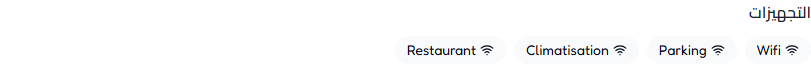
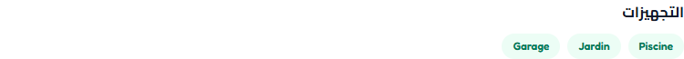
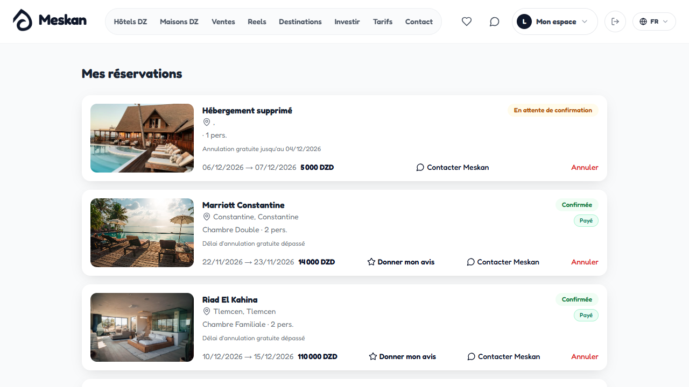
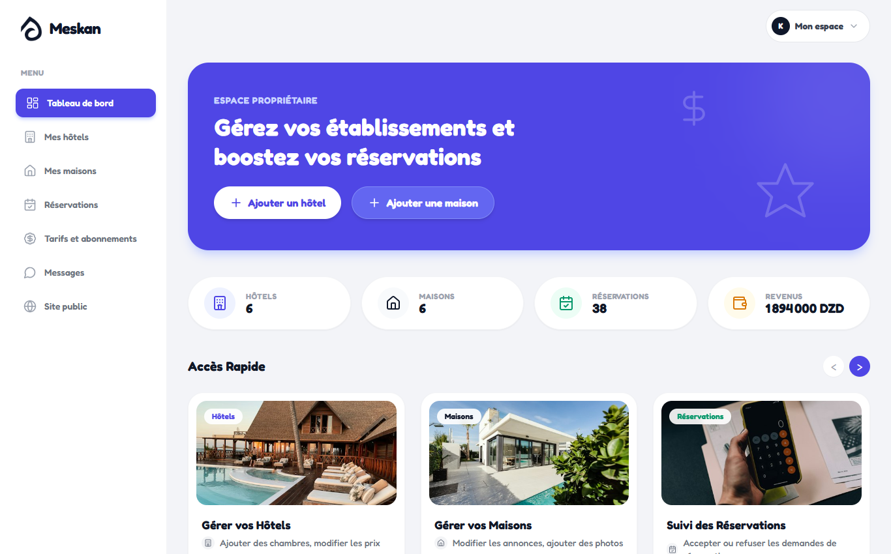
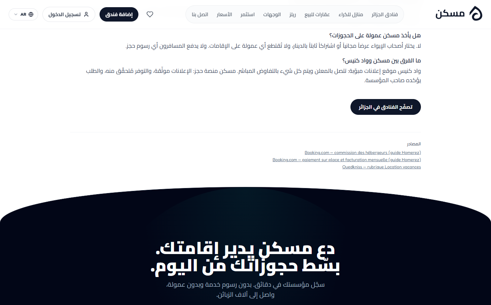
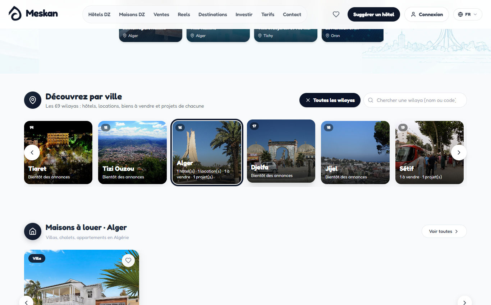
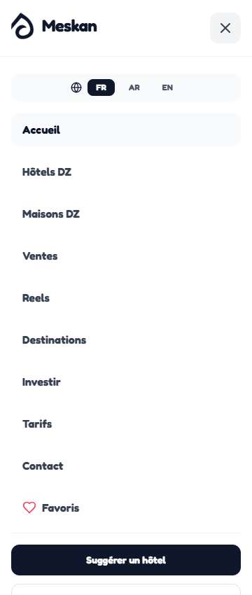
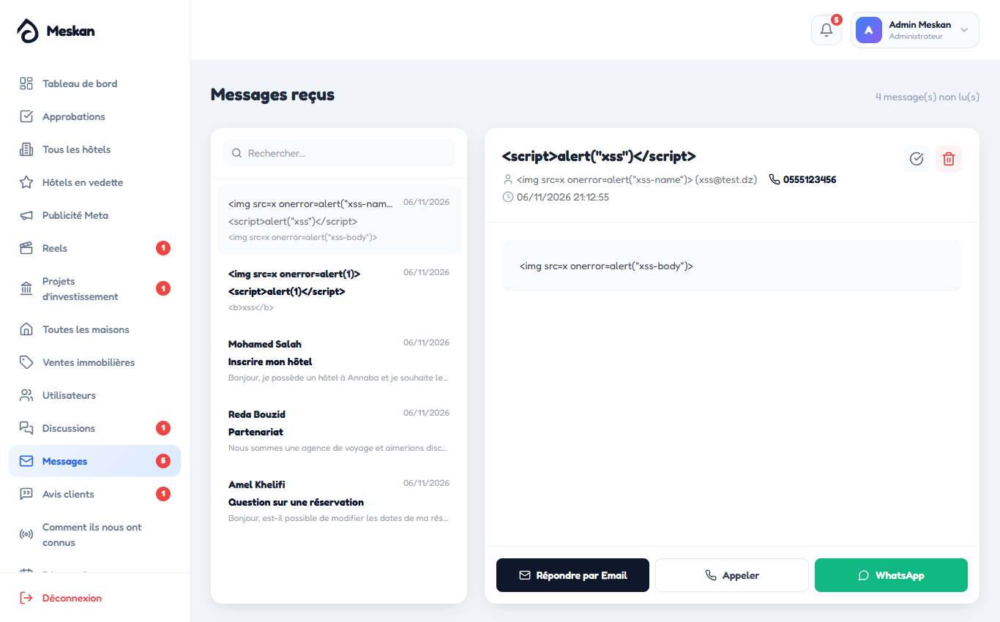

# تقرير الفحص الشامل لموقع Meskan — 2026-11-06

**البيئة:** نسخة محلية فقط (localhost:3000 للواجهة، localhost:5000 للخادم، قاعدة MongoDB مؤقتة في الذاكرة ببيانات تجريبية). لم تُلمس قاعدة البيانات الحقيقية ولا الموقع المنشور. البريد (SMTP) ورفع Cloudinary كانا معطّلين، فلم تُرسل أي رسالة حقيقية. لم يُعدَّل أي سطر من كود المشروع أثناء الفحص.

**الأدوات:** Playwright (متصفح Chrome حقيقي بدون واجهة)، Lighthouse 12 على نسخة إنتاج (`next build` + `next start`)، `npm audit`، سكربتات Node لاختبار الـ API والأمان، ومجموعة اختبارات المشروع الموجودة (`api.e2e.mjs`).

---

## 1. ملخص الاختبارات

| البند | العدد |
|---|---|
| الصفحات المختبرة (عناوين فريدة) | 65 عنواناً ← 173 فحص صفحة (3 لغات × 6 أحجام شاشة) |
| صفحات لوحات التحكم (مالك، بائع، مستثمر، مدير) | 28 صفحة، مع تسجيل دخول حقيقي لكل دور |
| الروابط الداخلية المفحوصة | 196 رابطاً، **0 معطّل** |
| اختبارات API الموجودة في المشروع | 489 ✓ / 0 ✗ |
| اختبارات API والأمان الإضافية | 107: **100 ✓ / 7 ✗** |
| اختبارات قاعدة البيانات (العلاقات والتكرار والتحقق) | 16: **15 ✓ / 1 ✗** |
| سيناريوهات المستخدم في المتصفح | 136: **130 ✓ / 6 ✗** (منها 3 ✗ خطأ في سكربت الاختبار، أُعيد فحصها ونجحت) |
| Lighthouse (نسخة الإنتاج) | 6 صفحات |
| **مجموع الاختبارات المنفّذة** | **≈ 755**، الناجحة ≈ 740 |
| **الأخطاء المكتشفة** | **17**: حرجة 0، مرتفعة 1، متوسطة 6، بسيطة 10 |

### ما نجح وتم التحقق منه بدليل
- **الحسابات:** إنشاء حساب، ورفض البريد المكرر (حتى بحروف كبيرة، وحتى عند 4 طلبات متزامنة: حساب واحد فقط). تسجيل الدخول والخروج. رسائل الخطأ تظهر في الواجهة. لا يمكن اكتشاف الحسابات الموجودة عبر رسائل الدخول أو «نسيت كلمة السر». حماية من التخمين: 429 بعد 20 محاولة.
- **حماية الصفحات:** كل صفحات المالك والبائع والمستثمر والمدير (32 صفحة) تحوّل الزائر إلى صفحة الدخول. حسابات الزبون والمالك والبائع والمستثمر محجوبة عن كل نقاط الإدارة (403).
- **IDOR:** 17 محاولة وصول إلى بيانات مستخدم آخر رُفضت كلها. شملت تعديل أو حذف فندق أو منزل أو غرفة أو عقار أو مشروع أو مراجعة أو ريل لغيرك، وإلغاء حجز غيرك، وقراءة محادثة غيرك مع مسكن.
- **الخصوصية (مسكن هو الوسيط الوحيد):** لا يظهر هاتف ولا بريد أي ناشر في 11 نقطة عامة (القوائم والتفاصيل). ولا تظهر كلمات السر المشفّرة حتى في قائمة المستخدمين عند المدير.
- **الحقن:** حقن NoSQL في الدخول وفي الاستعلامات والنماذج متعددة الأجزاء مرفوض. التعابير النمطية في البحث مُهرّبة. XSS المخزّن في رسالة التواصل وفي اسم المستخدم يظهر كنص عادي عند المدير، ولم يُنفَّذ أي `alert` طوال الفحص. توكن JWT المزوّر (`alg:none` أو توقيع خاطئ) مرفوض. CORS يرفض المواقع الغريبة.
- **الحجز:** حجز عبر الواجهة ← ظهر في «حجوزاتي» ← إلغاء عبر الواجهة ← الحالة `cancelled` في القاعدة. الإلغاء مرتين مرفوض. لا يمكن للزبون تحديد السعر بنفسه.
- **المفضلة وتعديل الملف الشخصي** يعملان عبر الواجهة ويُحفظان في القاعدة.
- **الصفحة الرئيسية:** 69 ولاية. الأسهم يمين ويسار تعمل. اختيار ولاية يفلتر الأقسام في مكانها، وزر «كل الولايات» يلغي الاختيار. البحث بالاسم والرقم (31) والعربية (وهران) يعمل، ورسالة «لا توجد ولاية» تظهر عند عدم وجود نتيجة.
- **صفحة الفنادق:** البحث والفلتر وحالة «لا توجد نتائج» تعمل.
- **التجاوب:** 0 تمرير أفقي في كل الصفحات على 360 و390 و430 و768 و1366 و1920 بكسل. قائمة الهاتف تفتح وتعرض الروابط.
- **اللغات:** `/ar` يعرض من اليمين لليسار مع `lang=ar`، و`/en` من اليسار لليمين. تبديل اللغة من الشريط يبقيك في نفس الصفحة (`/hotels` ← `/ar/hotels`).
- **SEO:** لكل صفحة عنوان ووصف و`canonical` وعنوان OG، ولا توجد عناوين مكررة. ملف `sitemap.xml` فيه 177 رابطاً مع hreflang لثلاث لغات. ملف `robots.txt` يحجب الصفحات الخاصة. نتيجة SEO في Lighthouse = 100 للصفحات العامة.
- **لوحة المفاتيح:** التنقل بزر Tab يُظهر إطار التركيز على كل العناصر (25/25)، ورابط «تخطّ إلى المحتوى» موجود، وتسجيل الدخول بلوحة المفاتيح فقط ممكن.
- **الصور:** لا توجد صورة بدون نص بديل (alt) ولا صورة معطلة.

---

## 2. جدول الأخطاء

### 🟠 مرتفع (High)

| # | الصفحة / الوظيفة | المشكلة | خطوات إعادة الإنتاج | السبب المحتمل | الحل المقترح |
|---|---|---|---|---|---|
| H1 | الموقع كله / Next.js | إصدار Next.js 14.2.35 عليه **25 ثغرة منشورة**، منها 3 «حرجة»: تنفيذ أوامر عن بعد عبر Image Optimization (صور AVIF وSVG)، وعلى الخوادم بنظام Windows. وعليه أيضاً SSRF وDoS. نقطة `/_next/image` مفعّلة وتردّ 200 رغم أن الكود لا يستعمل `next/image`. | `npm audit --omit=dev` في frontend، ثم `curl "localhost:3000/_next/image?url=…unsplash…&w=64&q=75"` ← 200 | إطار قديم، و`images.remotePatterns` في `next.config.mjs` يُبقي المحسِّن مفعّلاً | الترقية إلى Next 15.5.28 أو أحدث (أو 16) مع اختبار شامل. حل مؤقت: `images: { unoptimized: true }` أو حذف `remotePatterns`. **تصبح حرجة عند الانتقال إلى VPS** (على Vercel يُشغَّل المحسِّن على بنيتهم). |

### 🟡 متوسط (Medium)

| # | الصفحة / الوظيفة | المشكلة | خطوات إعادة الإنتاج | السبب المحتمل | الحل المقترح |
|---|---|---|---|---|---|
| M1 | معلوماتي الشخصية / تغيير كلمة السر | تتغيّر كلمة السر **دون طلب الكلمة القديمة** | `PUT /auth/update-profile {password:"x…"}` بتوكن صالح ← 200 | `updateProfile` لا يتحقق من `currentPassword` | طلب الكلمة الحالية، والتحقق منها بـ `comparePassword` قبل التغيير |
| M2 | تسجيل الخروج / الجلسة | التوكن **يبقى صالحاً 7 أيام بعد الخروج**، وهو محفوظ في `localStorage` (أي ثغرة XSS مستقبلاً = سرقة الحساب) | دخول ← نسخ التوكن ← خروج ← `GET /auth/me` بنفس التوكن ← 200 | JWT بلا قائمة إبطال، والتوكن يُرجَع في جسم الرد ويُخزَّن في المتصفح | الاكتفاء بكوكي HttpOnly (موجود أصلاً)، أو حفظ `tokenVersion` في المستخدم وزيادته عند الخروج |
| M3 | حذف فندق/منزل له حجوزات | الحذف يمرّ، والحجز يبقى «في انتظار التأكيد» **إلى الأبد** ولا يُبلَّغ الزبون | زبون يحجز ← المالك يحذف الفندق ← «حجوزاتي» تعرض «Hébergement supprimé · En attente de confirmation» (صورة `orphan_booking.png`) | `deleteHotel` لا يعالج الحجوزات المرتبطة | منع الحذف إن وُجدت حجوزات قادمة مؤكدة أو معلّقة، أو إلغاؤها تلقائياً مع إشعار الزبون |
| M4 | صفحة الفندق والمنزل والعقار / التجهيزات | التجهيزات (Parking، Climatisation، Piscine، Jardin، Garage…) **تظهر بالفرنسية** في النسختين العربية والإنجليزية رغم وجود ترجمتها. وفي صفحة الفندق **أيقونة الواي فاي بجانب كل تجهيز** | افتح `/ar/hotels/<id>` ← قسم التجهيزات (صورتا `bug_ar_amenities_hotel.png` و`bug_ar_amenities_sale.png`) | `{a}` بدل `{t(a)}` في `hotels/[id]/page.jsx:121` و`sales/[id]/page.jsx:208` و`houses/[id]/page.jsx:181`، و`<Wifi>` ثابتة | استعمال `t(a)` وأيقونة مناسبة لكل تجهيز |
| M5 | الأداء / الصفحة الرئيسية | الصفحة تحمّل **5.4 ميغابايت** في 72 طلباً. صور الولايات من 160 إلى 444 كيلوبايت لكل واحدة (المجلد 11 ميغابايت) بينما تُعرض بعرض نحو 200 بكسل. Lighthouse لم يستطع قياس LCP. | Lighthouse على `localhost:3001/` | صور ويكيميديا أصلية غير مصغّرة، و6 بطاقات أو أكثر ظاهرة فتُحمَّل رغم `loading=lazy` | تصغير صور الولايات إلى نحو 480 بكسل بصيغة WebP (نحو 25–40 كيلوبايت لكل صورة، أي توفير نحو 90%) |
| M6 | الأداء / صفحة الفندق والقوائم | صفحة الفندق: TBT = 2.37 ث وLCP = 4.6 ث (نتيجة 48/100). صفحة البيع LCP = 6.9 ث، وصفحة الفنادق LCP = 4.4 ث | Lighthouse (محاكاة هاتف) | الخريطة (Leaflet) وجافاسكربت ثقيل يُحمَّل مباشرة، وصور غير متجاوبة (توفير 110–576 كيلوبايت) | تحميل الخريطة عند الحاجة فقط (dynamic import)، و`srcset`/أحجام مصغّرة لصور Cloudinary |

### 🔵 بسيط (Low)

| # | الصفحة / الوظيفة | المشكلة | خطوات إعادة الإنتاج / الدليل | الحل المقترح |
|---|---|---|---|---|
| L1 | Backend / رفع الصور | يُقبل أي محتوى إن ادّعى أنه صورة (HTML أو SVG باسم `.png`). يُحفظ بامتداد صورة ويُقدَّم بـ `image/*` + `nosniff`، فالخطر محدود حالياً | `PUT /auth/avatar` بملف `<script>` ونوع `image/png` ← 200 | فحص البايتات الأولى (magic bytes) والاكتفاء بـ JPG/PNG/WebP |
| L2 | Backend / الأخطاء | الرد يحتوي على `stack` (مسارات الملفات) عندما `NODE_ENV≠production`. ورسائل Mongoose الداخلية تظهر للمستخدم (مثل "Cast to string failed…") | JSON غير صالح ← الرد فيه stack | التأكد من `NODE_ENV=production` على Render، وتعريب رسائل التحقق |
| L3 | Backend / المكتبات | nodemailer: 4 ثغرات «مرتفعة» (تحليل العناوين وDoS). uuid/gaxios: ثغرة متوسطة | `npm audit --omit=dev` في backend | `npm i nodemailer@latest` واختبار الإرسال |
| L4 | كل الصفحات / الزائر | كل صفحة تطلب `/auth/me` **مرتين** وتحصل على 401، فتظهر أخطاء في الـ Console | افتح أي صفحة دون دخول ← Console | عدم الطلب إن لم يكن هناك توكن أو كوكي، أو مسار `/auth/session` يرد 200 مع `user:null` |
| L5 | لوحة المالك / «Accès Rapide» | زرّا `<` و`>` **لا يفعلان شيئاً** (عنصر شكلي) | `/owner/dashboard` ← انقر `>` (صورة `bug_owner_dead_arrows.png`) | ربطهما بتمرير البطاقات أو حذفهما |
| L6 | `/ar/comparatif` | قائمة المصادر بالفرنسية: «commission des hébergeurs (guide Homerez)»، «rubrique Location vacances» | صورة `bug_ar_comparatif_sources.png` | إضافة ترجمتها |
| L7 | إمكانية الوصول | أزرار بلا اسم (أسهم الشريط في الرئيسية، أزرار العرض في `/houses`)، وحقول بحث وقوائم بلا label (`/hotels`، `/houses`، `/destinations`)، وتباين ضعيف (نصوص `slate-400`)، و`role=dialog` على `<aside>` في نافذة الترحيب، و`<dl>` غير صحيح في صفحة الفندق | Lighthouse a11y: 86–96 | إضافة `aria-label`، وتغميق الألوان إلى `slate-500/600`، و`
` |
| L8 | SEO | لا توجد صورة `og:image` في كل الصفحات الداخلية (42 صفحة)، فقط الرئيسية. وصفحة `/reels` بلا H1 | فحص الوسوم | صورة OG افتراضية في `pageMeta`، وH1 لصفحة الريلز |
| L9 | الأمان / الترويسات | لا توجد سياسة CSP كاملة (فقط `frame-ancestors`) | ترويسات الصفحة | CSP تدريجية بوضع `Report-Only` أولاً |
| L10 | المساحات | فتح رابط `/owner/dashboard` يغيّر دور الحساب تلقائياً (حسب التصميم «حساب واحد لكل شيء»)، لكنه أثر جانبي من مجرد رابط | زبون يفتح الرابط ← دوره يصبح `owner` | (اختياري) طلب نقرة تأكيد قبل التبديل |

---

## 3. الصور (Screenshots)

| الصورة | ما تُظهره |
|---|---|
|  | M4: التجهيزات بالفرنسية في الصفحة العربية، والواي فاي على الكل |
|  | M4: نفس المشكلة في صفحة العقار |
|  | M3: حجز «في انتظار التأكيد» لمسكن محذوف |
|  | L5: سهما «Accès Rapide» لا يعملان |
|  | L6: مصادر غير مترجمة |
|  | ✓ اختيار ولاية الجزائر يفلتر الأقسام في الرئيسية |
|  | ✓ قائمة الهاتف على 360px |
|  | ✓ محاولة XSS تظهر كنص عادي عند المدير |

---

## 4. تقرير الأداء

**Lighthouse** (نسخة إنتاج، محاكاة هاتف؛ نبّه Lighthouse إلى أن معالج الجهاز أبطأ من المتوقع، فالنتائج الحقيقية قد تكون أفضل قليلاً):

| الصفحة | الأداء | الوصول | أفضل الممارسات | SEO | FCP | LCP | TBT | CLS |
|---|---|---|---|---|---|---|---|---|
| `/` | — (تعذّر قياس LCP) | 86 | 96 | 100 | 1.4 ث | — | — | 0 |
| `/ar` | — | 86 | 96 | 100 | 1.5 ث | — | — | 0 |
| `/hotels` | 76 | 92 | 96 | 100 | 1.3 ث | 4.4 ث | 370 م.ث | 0 |
| `/hotels/<id>` | **48** | 89 | 96 | 100 | 1.5 ث | 4.6 ث | **2370 م.ث** | 0 |
| `/sales` | 68 | 96 | 96 | 100 | 1.2 ث | **6.9 ث** | 370 م.ث | 0 |
| `/login` | 90 | 100 | 96 | 69 (مقصود: noindex) | 1.2 ث | 2.9 ث | 250 م.ث | 0.002 |

- **حجم JavaScript الأول:** 215–262 كيلوبايت لكل صفحة (المشترك 87.6 كيلوبايت). مقبول.
- **API:** كل النقاط العامة ترد في **7–14 م.ث** (الوسيط من 5 طلبات)، والحجم 0.3–8 كيلوبايت، و`limit` محدود. ممتاز.
- **CLS = 0** في كل الصفحات: لا قفز في التصميم.
- **أكبر فرصة تحسين:** صور الولايات (M5)، ثم الخريطة وجافاسكربت صفحة الفندق (M6).

## 5. تقرير الأمان

| البند | النتيجة |
|---|---|
| المصادقة (JWT، bcrypt، HttpOnly، SameSite) | ✓ قوية. ✗ لا إبطال عند الخروج (M2) ولا طلب للكلمة القديمة (M1) |
| الصلاحيات حسب الدور | ✓ 40/40 محاولة وصول غير مصرح بها رُفضت |
| IDOR | ✓ 17/17 |
| NoSQL Injection / ReDoS | ✓ |
| XSS (مخزّن، JSON-LD) | ✓ لا يوجد `dangerouslySetInnerHTML` إلا JSON-LD مُهرَّب |
| تسريب بيانات الناشرين | ✓ لا يوجد |
| رفع الملفات | ⚠ (L1) |
| CORS / Clickjacking / nosniff / إخفاء X-Powered-By | ✓ |
| Rate limiting | ✓ الدخول (20)، التسجيل، التواصل |
| المكتبات | ✗ Next.js (H1)، nodemailer (L3) |
| أسرار في الكود | ✓ لا مفاتيح في الواجهة. `.env` غير متتبَّع في git |

---

## 6. ما لم يمكن اختباره (بوضوح)

- **الدخول بـ Google:** لا يوجد Client ID بعد.
- **رسائل البريد الحقيقية** (استعادة كلمة السر، تأكيد الحجز): عُطّل SMTP عمداً. تم التحقق فقط من أن الطلب يرد 200 وأن الرابط برمز صالح لمرة واحدة، دون فتح البريد.
- **التحقق من البريد الإلكتروني:** غير موجود في المشروع (التسجيل لا يتطلب تأكيداً). هذا قرار تصميم وليس خطأ.
- **بقاء البيانات بعد إعادة تشغيل الخادم:** القاعدة المحلية في الذاكرة وتُمسح عمداً عند كل تشغيل. لم أختبر Atlas الحقيقية حتى لا ألمس بيانات حقيقية.
- **رفع الصور إلى Cloudinary والفيديوهات الكبيرة:** معطّل محلياً، واختُبر الرفع المحلي فقط.
- **انتهاء الجلسة الفعلي بعد 7 أيام:** تم التحقق من وجود `exp` في التوكن ومن أن التوكن المنتهي يُرفض (اختبارات المشروع)، دون انتظار المدة.
- **الترجمة الآلية لمحتوى الإعلانات** (الأوصاف وأسماء الغرف والمراجعات): مزوّد الترجمة معطّل محلياً، لذلك يظهر هذا المحتوى بالفرنسية في `/ar`. هذا ليس خطأً محلياً، ويجب التحقق منه على الموقع المنشور.
- **الدفع:** لا يوجد دفع إلكتروني في المشروع (قرار تصميم).
- **Core Web Vitals الحقيقية من الزوار** وأجهزة هاتف فعلية: تم القياس بالمحاكاة فقط.

---

## 7. التوصيات مرتبة حسب الأولوية

1. **H1 — ترقية Next.js** (أو تعطيل `/_next/image` فوراً كحل مؤقت). ضروري قبل الانتقال إلى VPS.
2. **M1 + M2 — الجلسة وكلمة السر:** طلب الكلمة القديمة، وإبطال التوكن عند الخروج، والاكتفاء بالكوكي HttpOnly.
3. **M3 — الحجوزات اليتيمة:** منع حذف مسكن له حجوزات قادمة، أو إلغاؤها مع إشعار الزبون.
4. **M4 — ترجمة التجهيزات وإصلاح الأيقونة:** سريع جداً (3 أسطر) وظاهر لكل زائر عربي.
5. **M5 + M6 — الأداء:** تصغير صور الولايات إلى WebP (أكبر مكسب بأقل جهد)، ثم تحميل الخريطة عند الحاجة.
6. **L3 — تحديث nodemailer**، و**L1 — فحص محتوى الصور المرفوعة**.
7. **L4 إلى L8 — التحسينات الصغيرة:** إلغاء طلب `/auth/me` للزائر، والأسهم المعطلة، وترجمة صفحة المقارنة، وإمكانية الوصول، وصورة OG.
8. **L9 و L10:** عند الفراغ.

---
*ملفات الاختبار الخام (النتائج JSON والسكربتات) في `%TEMP%\qa\` على جهازك، ويمكن إعادة تشغيلها في أي وقت.*
